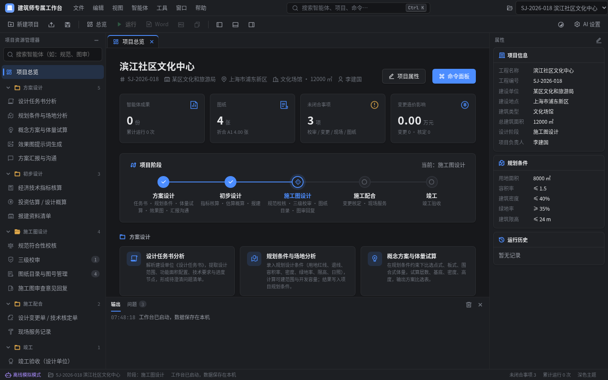
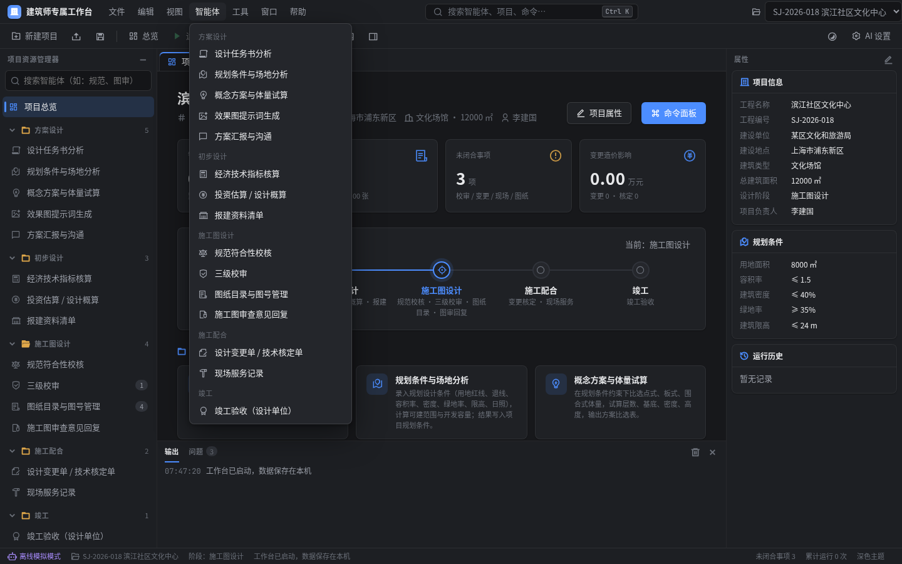
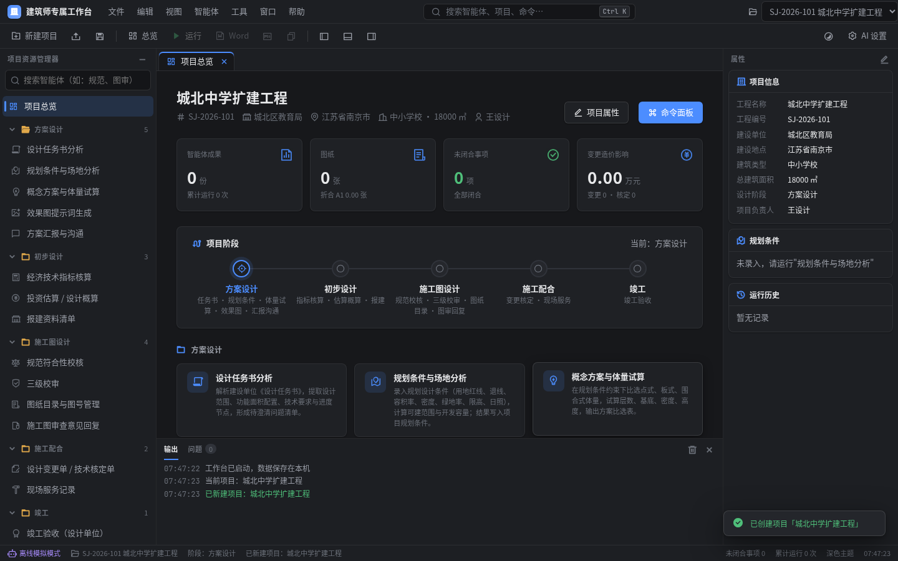
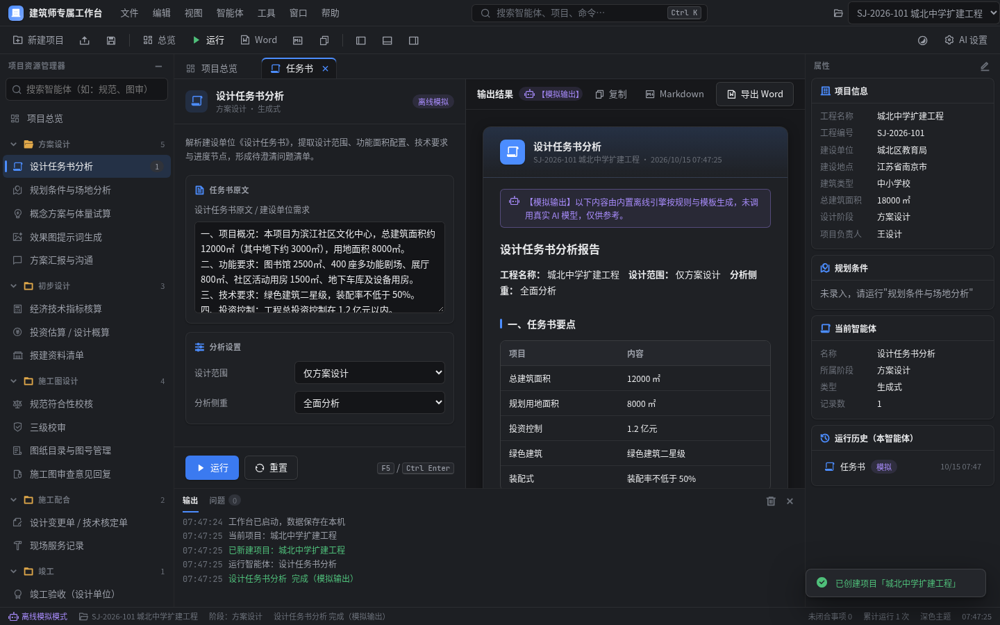

# ArchWorkbench

**2.7.1** · 建筑师专属工作台：用 AI 智能体覆盖方案设计、初步设计、施工图到竣工的全流程。

## 界面截图



*项目总览 / Project overview*



*智能体菜单 / Agent menu*



*新建项目 / 项目总览 / New project / overview*



*设计任务书 / Design brief*

## 功能特性

- 按建筑设计阶段组织智能体：方案设计、初步设计、施工图、施工配合、竣工验收。
- 项目总览、阶段时间线、属性面板与命令面板；数据保存在本机。
- 可离线模拟运行；可选接入 LLM 进行生成与校核。
- 支持导出 Word 等成果，并可用 Playwright 做端到端测试与截图。

## 技术栈

- Electron
- JavaScript
- Playwright（e2e）

## 从源码运行

源码在 `src/`（`package.json` 与 `src/main.js`）。本仓库不包含安装包。

```bash
cd src
npm install
npm start            # Electron 桌面端
# 仅预览渲染进程：
npm run preview      # http://localhost:5173
npm test             # Playwright
```

## 文档

- [源码与脚本](src/package.json)

## 许可证

`src/package.json` 声明为 MIT。仓库根目录未附带 LICENSE 文件。

---

## English

# ArchWorkbench

**2.7.1** · A workbench for architects: AI agents cover the full flow from concept and schematic design through construction documents and closeout.

## Screenshots


*项目总览 / Project overview*


*智能体菜单 / Agent menu*


*新建项目 / 项目总览 / New project / overview*


*设计任务书 / Design brief*

## Features

- Agents organized by design phase: schematic design, design development, construction documents, site support, and closeout.
- Project overview, phase timeline, property panel, and command palette; data stays local.
- Offline simulation mode, with optional LLM generation and review.
- Export to Word and similar artifacts; Playwright e2e tests can capture screenshots.

## Tech stack

- Electron
- JavaScript
- Playwright（e2e）

## Getting started

Source is under `src/` (`package.json` and `src/main.js`). This repository does not include installers.

```bash
cd src
npm install
npm start            # Electron desktop app
# Renderer-only preview:
npm run preview      # http://localhost:5173
npm test             # Playwright
```

## Documentation

- [源码与脚本](src/package.json)

## License

`src/package.json` declares MIT. There is no LICENSE file at the repository root.

